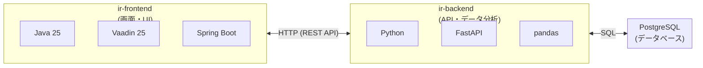

# ir-web

大学の教学データ（GPA、成績推移、成績分布等）を可視化・分析するための IR（Institutional Research）支援アプリケーションです。

---

## システム構成

本システムはフロントエンドとバックエンドの2つのコンポーネントで構成されています。



---

## 技術スタック

### フロントエンド（ir-frontend）

| カテゴリ | 技術 |
|---|---|
| フレームワーク | Vaadin 25 / Spring Boot 4 |
| 言語 | Java 25 / TypeScript (React) |
| ビルドツール | Maven / npm |
| DB アクセス | JdbcClient |
| API 通信 | Spring HTTP Interface（`@HttpExchange`） |

### バックエンド（ir-backend）

| カテゴリ | 技術 |
|---|---|
| フレームワーク | FastAPI |
| 言語 | Python |
| DB アクセス | psycopg2 |
| データ処理 | pandas / NumPy |
| テスト | HTTP Client (`.http` ファイル) |

### インフラ

| カテゴリ | 技術 |
|---|---|
| データベース | PostgreSQL |

---

## 各コンポーネント

詳細なセットアップ手順・アーキテクチャ・命名規則は各コンポーネントの README を参照してください。

| コンポーネント | 説明 | README |
|---|---|---|
| [ir-frontend](./ir-frontend/) | 画面・UI を担当。Vaadin + Spring Boot ベースとし、可視化のための React グラフコンポーネントも作成します。 | [README](./ir-frontend/README.md) |
| [ir-backend](./ir-backend/) | API・データ分析を担当。FastAPI で構築。 | [README](./ir-backend/README.md) |
| [docker](./docker/) | データベース（PostgreSQL）の Docker 環境。ローカル開発やサーバー構築時に使用します。 | [README](./docker/README.md) |

---

## 環境構築

開発環境の構築手順は、以下のPDFを参照してください。
（ただし、2024年時点の資料であるため更新が必要。）
[setup-guide.pdf](./setup-guide.pdf)

---

## 対象ユーザ

本システムは大学に所属する以下のユーザを想定しています。

| ユーザ | 役割 |
|---|---|
| 管理者 | ユーザの追加・削除などシステムの管理 |
| IR 委員会所属 | IR の取り決めを行う |
| 教員 | 大学に所属する教員 |
| 学生 | 大学に所属する学生 |

---

## リポジトリ構成

```
ir-web/
├── README.md              … このファイル（プロジェクト全体の概要）
├── .gitignore
├── ir-frontend/           … フロントエンド（Vaadin + Spring Boot）
│   ├── README.md          … フロントエンドの情報
│   ├── pom.xml
│   └── src/
└── ir-backend/            … バックエンド（FastAPI）
    ├── README.md          … バックエンドの情報
    ├── requirements.txt
    └── src/
```

##ライセンス

```
1. 非営利利用
本ソフトウェアの利用は、非営利目的での利用に限り許可されます。

「非営利」とは、主として商業的な利益や金銭的な報酬を得ることを目的としない、またはそのような利益や報酬を得ることを主な目的として行われないことを意味します。

2. 継承

本ソフトウェアを改変または翻案して再配布する場合は、本ソフトウェアと同じ利用条件の下で公開しなければなりません。

3. 再配布

非営利目的に限り、あらゆる媒体や形式で本作品を再配布、改変、および本作品に基づく新たな作品の作成を行うことができます。

4. 著作者表示の免除

本ソフトウェア「IRweb」の利用にあたり、著作者名および著作権表示の記載は不要とします。

ただし、本ソフトウェアを利用する場合は、利用状況の把握を目的として、以下のGoogleフォームからご協力お願いいたします。

利用登録フォーム： https://forms.gle/GCWgxpEpawfvegjq7

利用者は、本ソフトウェアの利用開始にあたり、上記フォームへの登録にご協力ください。
```
