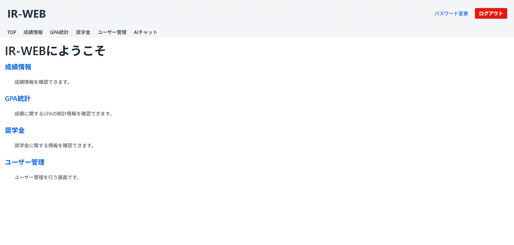
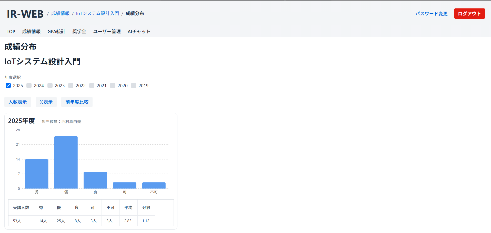
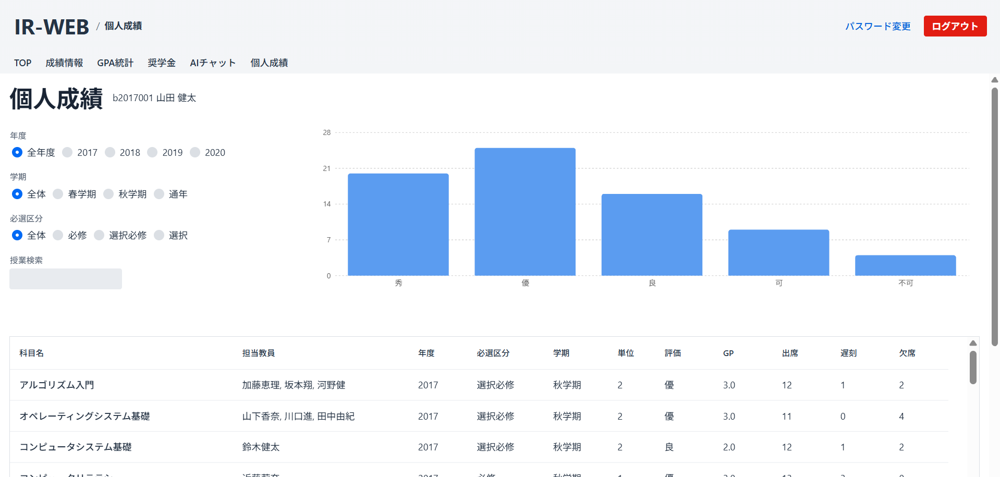
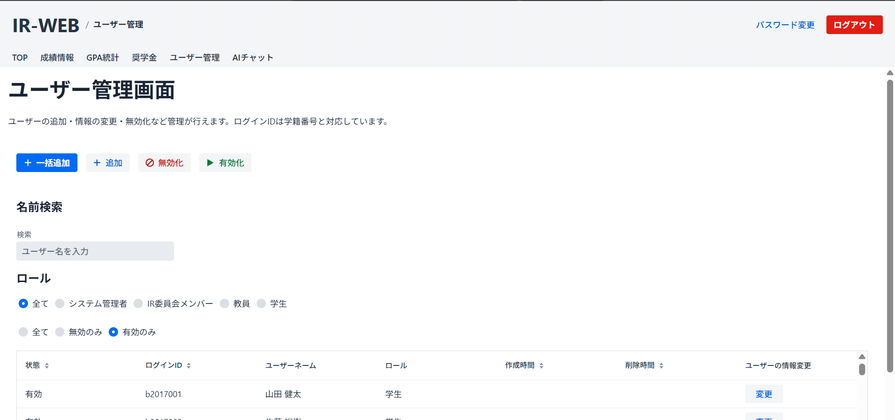
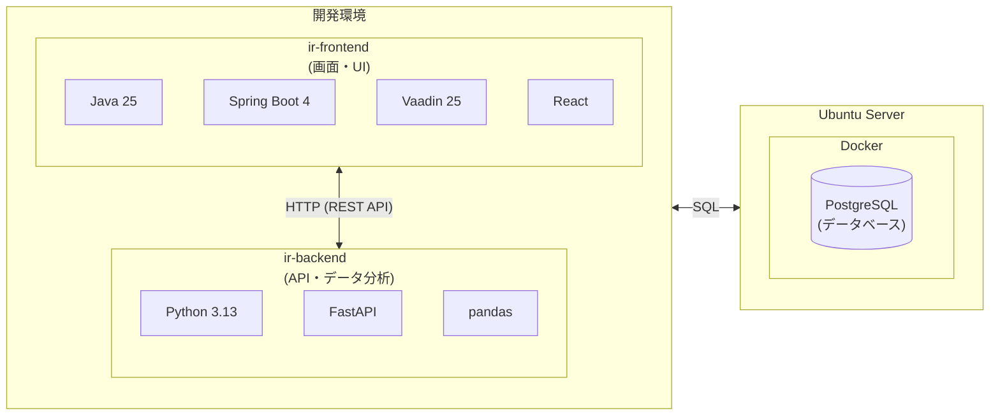

# ir-web

大学の教学データ（GPA、成績推移、成績分布等）を可視化・分析するための IR（Institutional Research）支援アプリケーションです。

---

## 目次

- [プロジェクトについて](#プロジェクトについて)
- [機能紹介](#機能紹介)
- [スクリーンショット](#スクリーンショット)
- [対象ユーザ](#対象ユーザ)
- [システム構成](#システム構成)
- [技術スタック](#技術スタック)
- [環境構築](#環境構築)
- [各コンポーネント](#各コンポーネント)
- [リポジトリ構成](#リポジトリ構成)
- [ライセンス](#ライセンス)

---

## プロジェクトについて

本システムは、大学の有志の学生が集まって開発している IR（Institutional Research）支援アプリケーションです。

大学の教学データ（GPA、成績推移、成績分布等）を可視化し、教員や IR 委員会だけでなく、学生自身も自分の学びや授業の傾向を把握できるようにすることを目指しています。

---

## 機能紹介


### 全ユーザー向け機能

- **授業絞り込み**：学年・学科・必修/選択・開講学期で授業を絞り込み（最新年度の情報を表示）
- **成績分布**：評価（秀・優・良・可・不可）ごとの人数を年度別に表示。人数表示・割合表示・前年度比較に対応
- **授業評価アンケート**：アンケートの回答結果とコメントを年度別に表示
- **履修者推移**：履修者数の年度ごとの推移を表示。人数・割合の切り替えや、他の科目との比較が可能
- **GPA統計**：開講年度・学部・学科・学年ごとのGPA分布をヒストグラムで表示（平均・最大・最小・標準偏差つき）
- **奨学金**：奨学金の受給割合と受給者数の推移を、種別・学部・学科・学年で絞り込んで表示

### 学生向け機能

- **個人成績**：自分のGPAと履修した授業の一覧を表示
- **授業詳細**：授業ごとの自分の成績・出席状況と、自分のアンケート回答の振り返りを表示

### 教員向け機能

- **担当授業**：担当している授業の一覧と、授業ごとの成績分布・授業情報を表示

### 管理者向け機能

- **ユーザー管理**：ユーザーの追加（1件ずつ / CSVで一括）・情報変更・無効化・有効化

### 共通機能

- **ログイン・パスワード変更**


---

## スクリーンショット

※ 画面に表示されているデータはすべてダミーデータです。

### TOP



### 成績分布



### 個人成績（学生向け）



### ユーザー管理（管理者向け）



---

## 対象ユーザ

本システムは大学に所属する以下のユーザを想定しています。
すべてのユーザが、授業ごとの成績分布・履修者推移・アンケート結果などの共通メニューを利用できます。

| ユーザ | ロール名 | 主にできること |
|---|---|---|
| 管理者 | `admin` | ユーザーの追加・無効化などシステムの管理 |
| IR 委員会 | `ir_committee` | 共通メニューの閲覧 |
| 教員 | `teacher` | 担当授業の成績の確認 |
| 学生 | `student` | 自分の成績（個人成績）の確認 |

---

## システム構成

本システムはフロントエンド・バックエンド・データベースの3つのコンポーネントで構成されています。



---

## 技術スタック

### フロントエンド（ir-frontend）

| カテゴリ | 技術 |
|---|---|
| フレームワーク | Vaadin 25 / Spring Boot 4 |
| 言語 | Java 25 / TypeScript (React) |
| ビルドツール | Maven / npm |
| DB アクセス | JdbcClient |
| 認証 | Spring Security |
| API 通信 | Spring HTTP Interface（`@HttpExchange`） |

### バックエンド（ir-backend）

| カテゴリ | 技術 |
|---|---|
| フレームワーク | FastAPI/Uvicorn |
| 言語 | Python 3.13 |
| DB アクセス | psycopg2 |
| データ処理 | pandas / NumPy |
| API 動作確認 | HTTP Client (`.http` ファイル) |

### インフラ

| カテゴリ | 技術 |
|---|---|
| データベース | PostgreSQL 14.11 |
| コンテナ | Docker / Docker Compose |

---

## 環境構築

開発環境の構築手順は、以下のPDFを参照してください。
[setup-guide.pdf](./setup-guide.pdf)

---

## 各コンポーネント

詳細なセットアップ手順・アーキテクチャ・命名規則は各コンポーネントの README を参照してください。

| コンポーネント | 説明 | README |
|---|---|---|
| [ir-frontend](./ir-frontend/) | 画面・UI を担当。Vaadin + Spring Boot ベースとし、可視化のための React グラフコンポーネントも含みます。 | [README](./ir-frontend/README.md) |
| [ir-backend](./ir-backend/) | API・データ分析を担当。FastAPI で構築。 | [README](./ir-backend/README.md) |
| [docker](./docker/) | データベース（PostgreSQL）の Docker 環境。ローカル開発やサーバー構築時に使用します。 | [README](./docker/README.md) |

---

## リポジトリ構成

```
ir-web/
├── README.md              … このファイル（プロジェクト全体の概要）
├── .gitignore
├── setup-guide.pdf        … 開発環境の構築手順（PDF）
├── docs/                  … README 用の画像
├── docker/                … データベース（PostgreSQL）の Docker 環境
├── ir-frontend/           … フロントエンド（Vaadin + Spring Boot）
│   ├── README.md          … フロントエンドの情報
│   ├── pom.xml
│   └── src/
└── ir-backend/            … バックエンド（FastAPI）
    ├── README.md          … バックエンドの情報
    ├── requirements.txt
    └── src/
```

---

## ライセンス

```

1. 非営利利用
本ソフトウェアの利用は、非営利目的での利用に限り許可されます。

「非営利」とは、主として商業的な利益や金銭的な報酬を得ることを目的としない、またはそのような利益や報酬を得ることを主な目的として行われないことを意味します。

2. 継承

本ソフトウェアを改変または翻案して再配布する場合は、本ソフトウェアと同じ利用条件の下で公開しなければなりません。

3. 再配布

非営利目的に限り、あらゆる媒体や形式で本作品を再配布、改変、および本作品に基づく新たな作品の作成を行うことができます。

4. 著作者表示の免除

本ソフトウェア「IRweb」の利用にあたり、著作者名および著作権表示の記載は不要とします。

ただし、本ソフトウェアを利用する場合は、利用状況の把握を目的として、以下のGoogleフォームからご協力お願いいたします。

利用登録フォーム： https://forms.gle/GCWgxpEpawfvegjq7

利用者は、本ソフトウェアの利用開始にあたり、上記フォームへの登録にご協力ください。

```